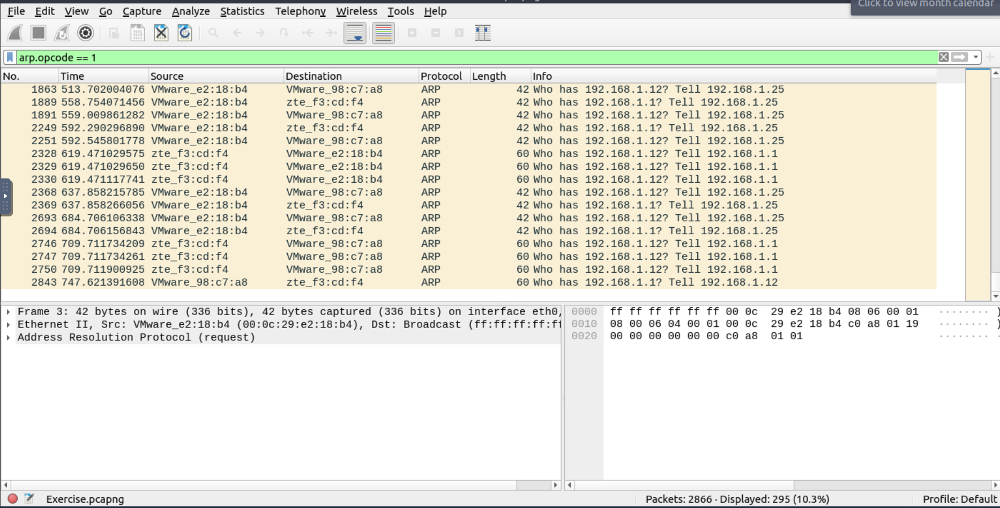
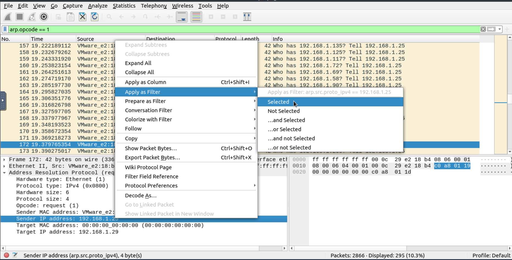
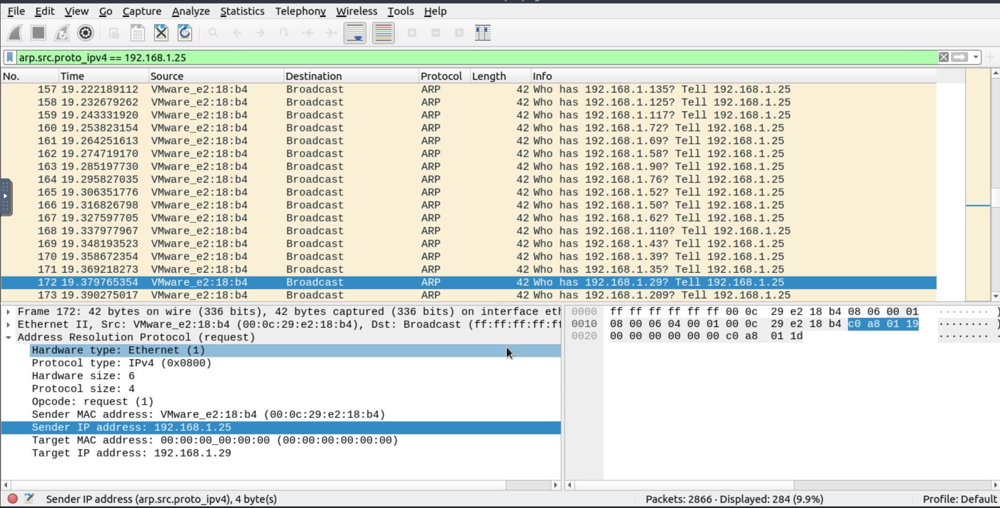
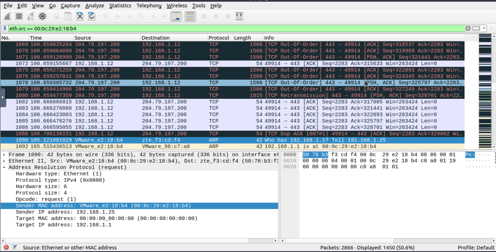
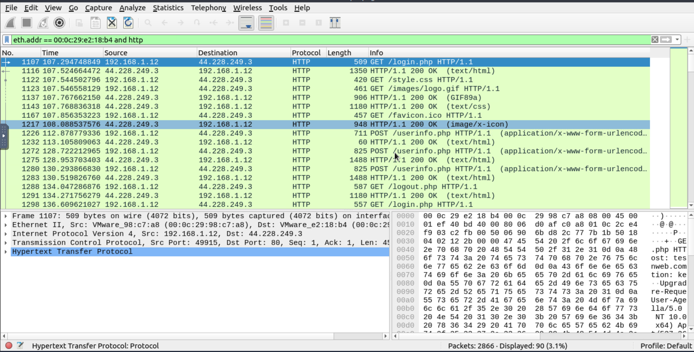
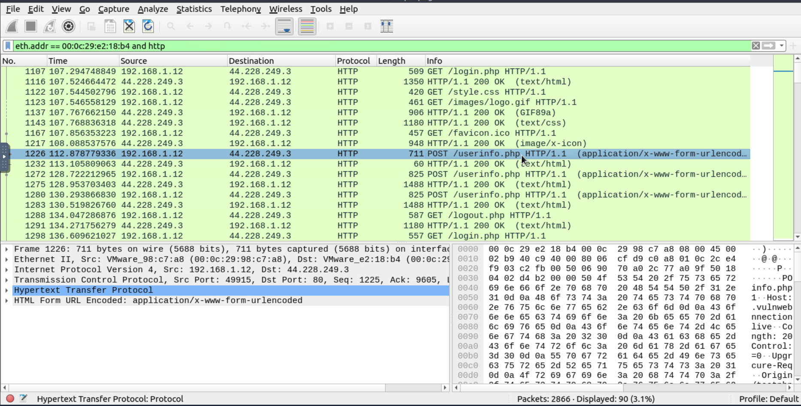
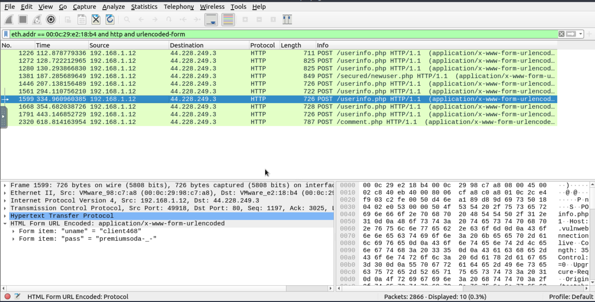
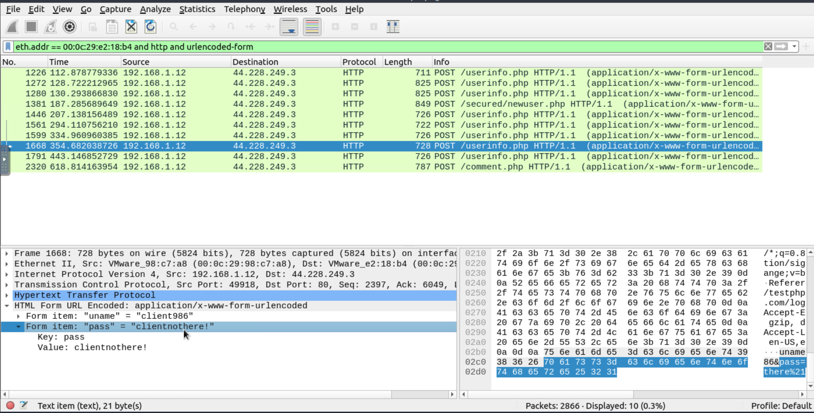

Welcome to this walkthrough of the 
<h1>Wireshark: Traffic Analysis</h1> Room on TryHackMe

Room Access: https://tryhackme.com/room/wiresharktrafficanalysis

---
---

<h2>Task 3 - ARP Poisoning & Man In The Middle!</h2>

<strong>What is the number of ARP requests crafted by the attacker?</strong>
 
<code>A: 284</code>

To identify the number of ARP requests generated by the attacker, I apply the following display filter to show only ARP request packets:
<code>arp.opcode == 1</code> 
 

The opcode value 1 represents an ARP request, while 2 represents an ARP reply.

Looking at the filtered packets, I can see that the ARP requests are from multiple IP addresses.
However, a significant number of requests are associated with <code>192.168.1.25</code>, making it a potential source of the suspicious activity.

To narrow down the results, I can combine the ARP request filter with the suspected attacker's source protocol IP address: <code>192.168.1.25</code>

After applying the filter, Wireshark displays 284 matching packets, confirming the answer.

<code>arp.src.proto_ipv4 == 192.168.1.25 && arp.opcode == 1</code>

---

<strong>What is the number of HTTP packets received by the attacker?</strong>
 
<code>A: 90</code>

To investigate HTTP traffic associated with the attacker during the ARP poisoning attack, I can use Wireshark's display filters to analyse packets based on their Ethernet (MAC) addresses.

During an ARP poisoning/spoofing attack, the attacker manipulates IP-to-MAC address mappings, tricking devices into sending network traffic to the attacker's MAC address instead of the legitimate destination.

This makes MAC address filtering particularly useful when investigating Man-in-the-Middle (MITM) attacks, as relying solely on IP addresses may not reveal traffic being redirected through the attacker.
To do this I used the filter: 
<code>eth.src == 00:0c:29:e2:18:b4</code>

This filter displays packets where the source MAC address matches 00:0c:29:e2:18:b4, allowing me to examine traffic transmitted from that MAC address.

Since the question specifically asks for the number of HTTP packets, I need to refine our filter by adding the HTTP protocol:
<code>eth.src == 00:0c:29:e2:18:b4 and http</code>

After applying the filter, Wireshark displays 90 matching HTTP packets, confirming the answer.

---

<strong>What is the number of sniffed username&password entries?</strong>
 
<code>A: 6</code>

Building on the previous question, I can examine the captured HTTP packets more closely.
Looking through the HTTP traffic, I notice requests associated with userinfo.php, an endpoint that may handle user authentication or profile information.
This makes it a useful starting point for investigating potentially exposed credentials.

To narrow down the results, I extend my previous filter by including urlencoded-form, which identifies HTTP packets containing URL-encoded form data.

Apply the following Wireshark display filter:

<code>eth.addr == 00:0c:29:e2:18:b4 and http and urlencoded-form</code>

After applying the filter and examining the form submissions, I identify 6 username and password entries, confirming the answer.

Note: In this particular capture, the urlencoded-form filter alone would be sufficient, as all matching packets are associated with the attacker's MAC address. However, including the MAC address and HTTP filters makes the investigation more targeted.

---

<strong>What is the password of the "Client986"?</strong>
 
<code>A: clientnothere!</code>

In one of the 6 packets I found "Client986"

---

<strong>What is the comment provided by the "Client354"?</strong>
 
<code>A: Nice Work!</code>

In one of the 6 packets I found "Client354"
