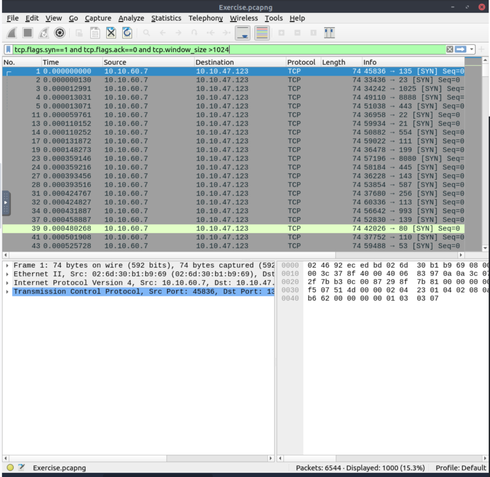
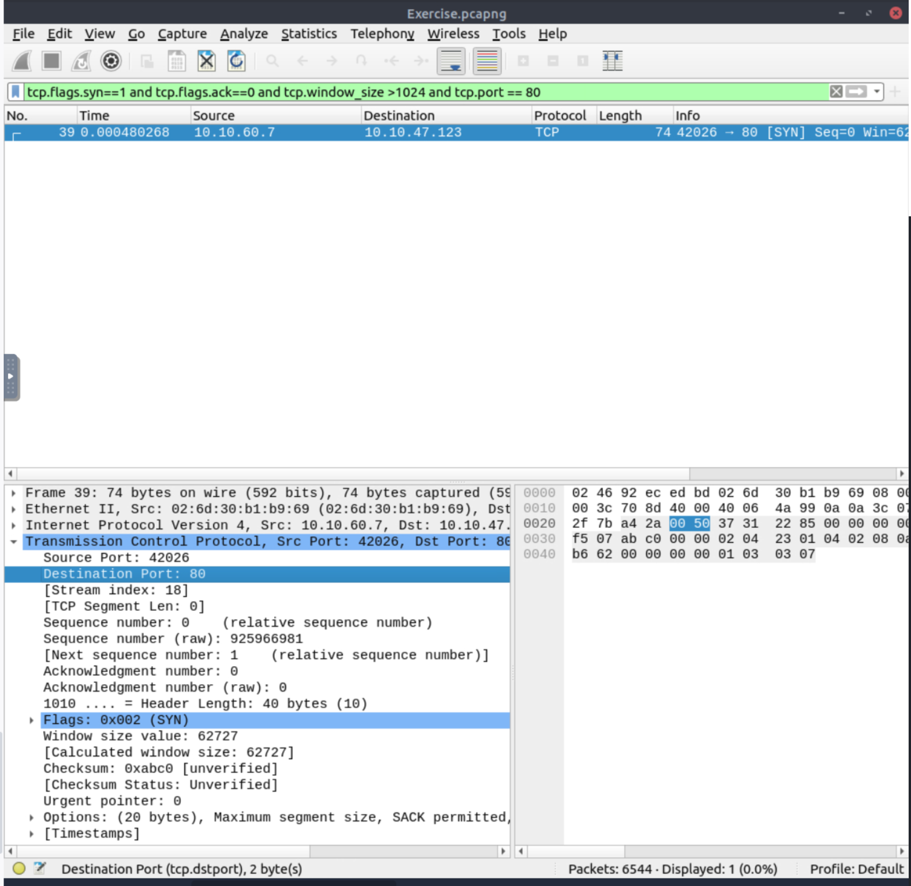
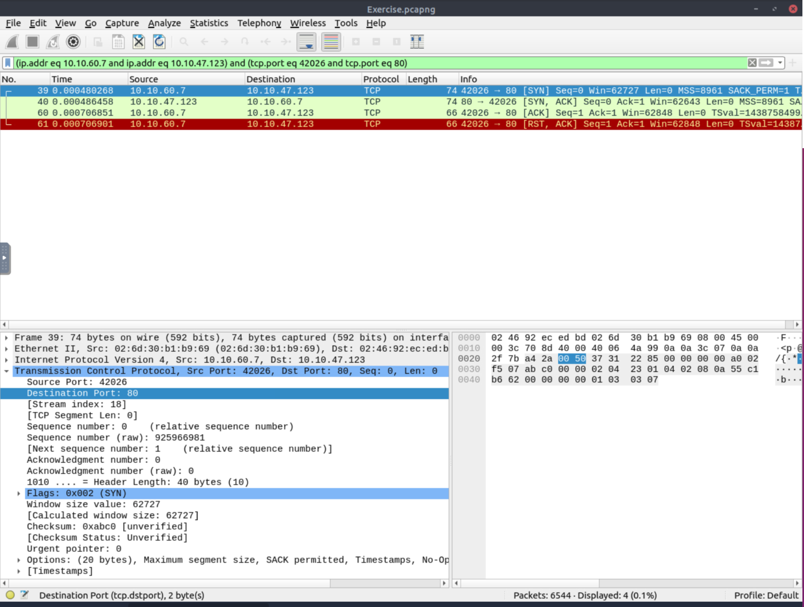
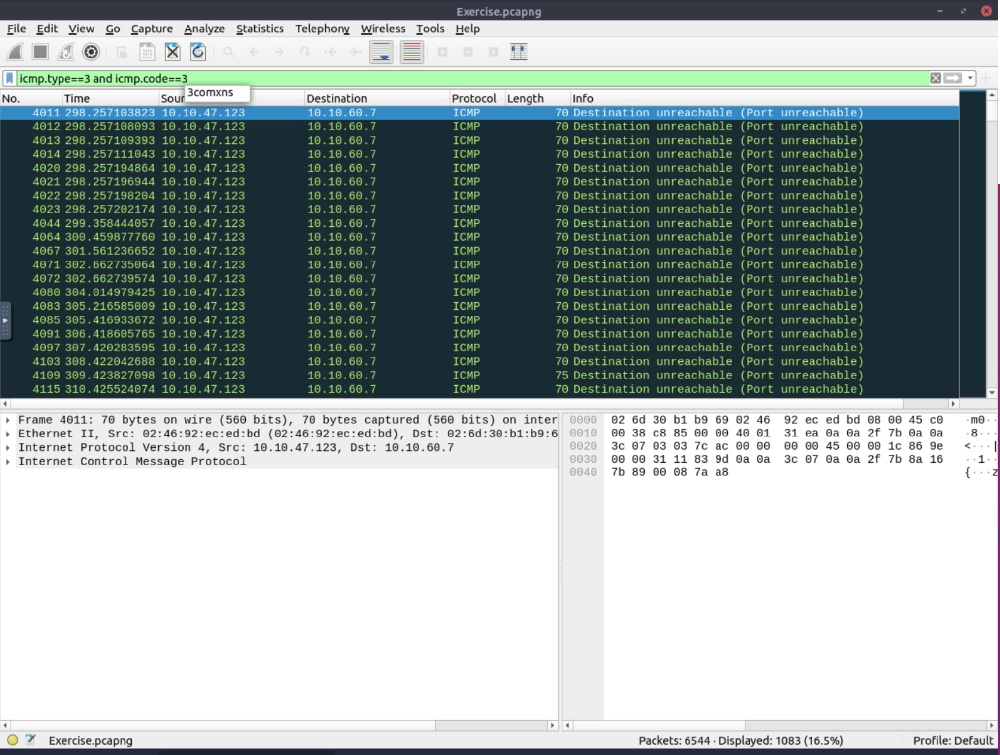
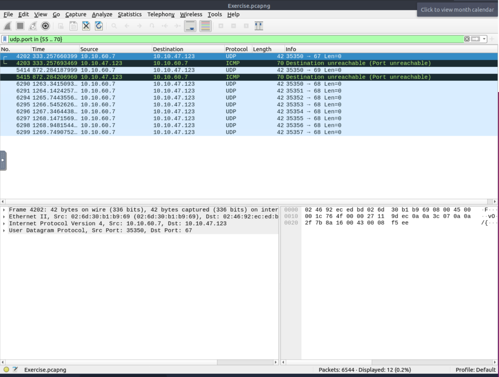

Welcome to this walkthrough of the 
<h1>Wireshark: Traffic Analysis</h1> Room on TryHackMe

Room Access: https://tryhackme.com/room/wiresharktrafficanalysis

---
---

<h2>Task 1</h2>
<code>No questions</code>

---
---

<h2>Task 2</h2>

<strong>What is the total number of the "TCP Connect" scans?</strong>
 
<code>A: 1000</code>

To identify the TCP SYN packets associated with the TCP Connect scan, use the following Wireshark display filter:
 
<code>tcp.flags.syn==1 and tcp.flags.ack==0 and tcp.window_size >1024</code>
 

This filter displays TCP packets where the SYN flag is set, the ACK flag is not set, and the calculated TCP window size is greater than 1024 bytes.
Applying this filter returns <strong>1000</strong> packets, so the answer is <strong>1000</strong>.

---

<strong>Which scan type is used to scan the TCP port 80?</strong>
 
<code>A: TCP Connect</code>

To determine which scan type was used against TCP port 80, I added a port condition to the previous Wireshark display filter:
 
<code>tcp.flags.syn==1 and tcp.flags.ack==0 and tcp.window_size >1024 and tcp.port == 80</code>

This filter returned one packet associated with TCP port 80.

Next, we need to determine whether the TCP three-way handshake was completed. A TCP Connect scan completes the full handshake:

SYN → SYN/ACK → ACK

In contrast, a typical TCP SYN scan does not complete the connection. After receiving a SYN/ACK response from an open port, the scanner normally sends an RST packet instead of completing the handshake with an ACK.

To inspect the entire TCP conversation in Wireshark, right-click the packet and select:

Conversation Filter → TCP

The resulting conversation shows the complete TCP three-way handshake, including the final ACK.

Therefore, the scan performed against TCP port 80 is consistent with a <strong>TCP Connect</strong> scan.

---

<strong>How many "UDP close port" messages are there?</strong>

<code>A: 1083</code>

To identify UDP closed-port responses in Wireshark, use the following display filter:

<code>icmp.type==3 and icmp.code==3</code>

This filter matches ICMP Destination Unreachable packets with the Port Unreachable code.
When a UDP probe is sent to a closed UDP port, the target typically responds with an ICMP Type 3, Code 3 message, indicating that the destination port is unavailable.
Applying this filter returns <strong>1083</strong> packets.
Therefore, the total number of UDP closed-port messages is <strong>1083</strong>.

---

<strong>Which UDP port in the 55-70 port range is open?</strong>

<code>A: 68</code>

To investigate UDP traffic in the port range 55–70, we can use the following Wireshark display filter:

<code>udp.port in {55 .. 70}</code>

Wireshark may also display related ICMP packets when using this filter. Although ICMP does not run over UDP, ICMP error messages include part of the original packet that caused the error, including the UDP header. Wireshark can therefore associate the ICMP error with the corresponding UDP source or destination port.
The closed ports generate ICMP Port Unreachable responses, whereas port 68 shows traffic without such a closed-port response. Based on the packet capture, the UDP port identified as open is therefore:

UDP port: <strong>68</strong>

---
---

